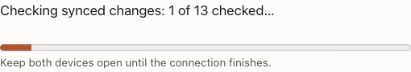

# Device approval progress — bounded presentation phase

Base: signed `465c5e07`. The three preceding performance patches are now signed commits
`e31b5eaf`, `1f2d9cd2`, `465c5e07`. Each commit tree independently matches its immutable
patch verification; see `prior-patch-commits.json`. This new follow-up is uncommitted and
undeployed. General release qualification remains paused.

## Outcome and evidence

The [contract](../../account-enrollment-progress.md) separates verified history progress,
local reconstruction, snapshot publication, access delivery and installation confirmation.
The indicator has a real completed-work counter within a known substep and an indeterminate
bar otherwise. It grants no authority, persists nothing and adds no timer or network request.

Four new real-history regressions plus 14 existing history/handoff cases pass. They verify
ordered counters, no advancement on invalid signatures, callback-failure isolation and
retirement during an actual read. Every byte of the preceding source test remains unchanged;
only four cases were appended (`existing-tests-preserved.json`). Twelve registry and 25
affected adapter checks pass. TypeScript, normal changed-source lint, formatting, build,
initial-JS budgets and built-origin isolation pass separately. No full-suite or qualification
claim is made.

Six unique packaged Chromium journeys pass: four existing batching/compatibility/fault cases
and two new progress cases. The new journeys then pass again with added held-installation
checks and cropped screenshots. They exercise both original and joined approvers, hold genuine
server replies before client verification, require zero then advancing counters, refuse a
substituted signature before any key delivery, clear progress on error/navigation, and resume
the exact saved approval without a second comparison. The final controls also hold the new
device's installation confirmation and require an explicit waiting message with no early
Open-writing button. Releasing it completes certification and preserves the exact Goals text.
These use disposable services/storage and virtual authenticators, not personal data, Firefox,
Bitwarden, physical phones or a locked-screen execution test.

All runtime files match the frozen packaged build (`runtime-identity.json`). The root preview's
108 build files remain byte-identical to the prior baseline; port 8443 and production were not
updated. The planning manifest remains blocked: 867 obligations, 323 unresolved. An independent
comparison preserves all 866 preceding obligations, their assertions, deadlines, stages and
blocks; the new browser file is required but blocked from aggregate credit pending adapter
review (`qualification-preserved.json`). All 78 specified constructions and 14 open ones remain.
Only an existing source-site line and runtime hashes changed; no cryptographic domain changed.

## Inconvenient results retained

- The first TypeScript check found an exact-optional callback property assigned `undefined`;
  conditional inclusion repaired it. The initial optional type-aware lint found four new
  unbound callback declarations; function properties repaired them. Its final three findings
  reproduce exactly on the signed base (two pre-existing `source.sign` references and one
  editor registration reference). Normal repository lint passes. These optional findings
  remain unresolved, not suppressed or presented as new product failures.
- The initial formatting check flags only newly appended test assertions. The final formatted
  file still starts with the complete byte-identical old file. The final exact-source 18-case
  history/handoff run passes. No old assertion or formatting was changed.
- Initial inventory/registry checks correctly detect the new source and shifted source-site
  line. Reviewed census/manifest refreshes preserve all prior blocks; a final registry run
  passes. The first attempted registry command named a nonexistent script; its error is retained.
- A disposable snapshot/build command started from the scratch parent instead of the repository;
  archive and build could not start. A subsequent build had an incorrectly transcribed full
  revision in display metadata. No browser checks used that build: it was rebuilt with the
  actual `465c5e07cbfd9480666df269e4a1be223546a198-dirty` provenance first. The final frozen runner
  asserts its working directory. A scratch baseline extraction also needed its directory
  created before retry. These are setup mistakes, not discarded application measurements.
- Budget/origin checks run against the frozen build print a missing-Git-metadata warning while
  falling back for unused display metadata. Both checks pass; the tested build itself had
  explicit correct provenance. No timing comparison is inferred from these functional checks.

The prospective protocol, runner configurations, raw logs/reports, source identities and
small numeric/screenshot evidence are retained here. Disposable browser credentials, service
keys, database contents and unlock/comparison codes remain outside Git. `SHA256SUMS` identifies
this packet. Larger performance changes need a separately attributed owner/replay experiment;
the receiver's bounded prefetch, exact-inventory reuse and cooperative preparation are concrete
patterns for that next phase, not additional speedups implemented here.
